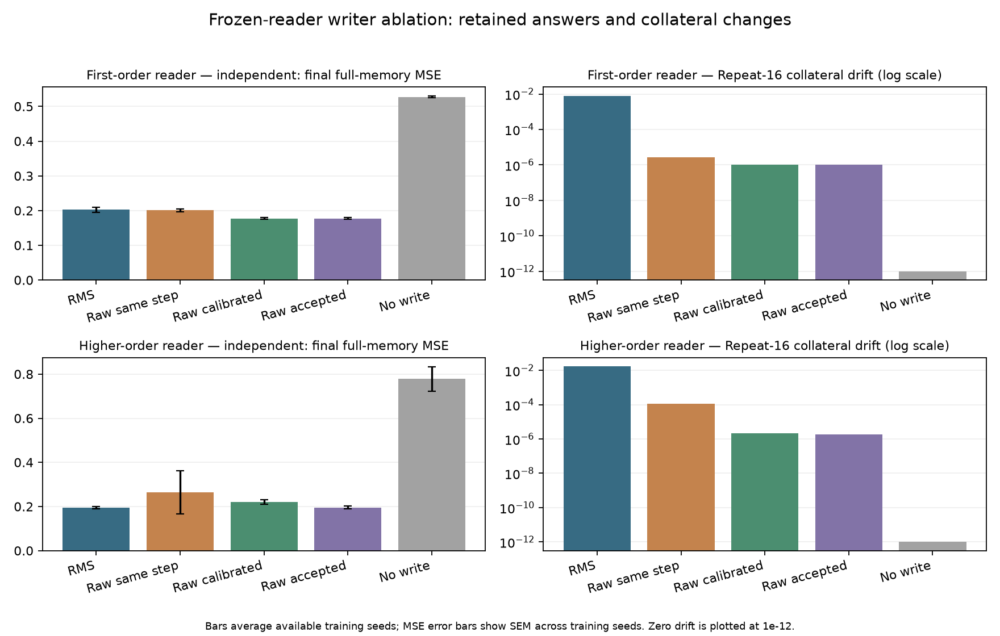

# SilliSalaatti

An executable experiment in quantized, error-correcting streaming memory, continuing Tupsu, MultipleTemporalLenses, GraphNN and PhaseGraphFastWeightCell.

**The first experiment is implemented and measured.** Six real upstream meta-trained checkpoints, three seeds per reader family, 128 held-out streams per schedule, five writer policies and four schedules produce 120 frozen-reader runs. [Results and interpretation](results/frozen_meta/REPORT.md).

**Outcome:** RMS normalization contributes strongly to repeat-write churn. Calibrating raw updates lowers first-order readers’ mean 64-rewrite MSE from **0.2030 to 0.1774**. Higher-order readers remain unstable under simple normalization removal. **No replacement passes the complete predeclared rule in all three seeds of either family.** This is a frozen-reader intervention with test-time distribution shift; retrained superiority and a phase-specific advantage are not established.



## Install and run

Python 3.10+ and PyTorch 2.5+. Keep your existing CUDA-enabled PyTorch installation for the RTX 3060. Local verification used Python 3.12 and PyTorch 2.5.1 CPU.

```bat
git clone --branch codex/streaming-memory-design https://github.com/anttiluode/SilliSalaatti.git
cd SilliSalaatti
python -m pip install -e ".[test,plots]"
python -m pytest -q
```

Run one supplied checkpoint at full frozen settings, or a short diagnostic:

```bat
python -m sillisalaatti.benchmark --checkpoint checkpoints/meta/seed41-phase_first_order.pt --output runs/one
python -m sillisalaatti.benchmark --checkpoint checkpoints/meta/seed41-phase_first_order.pt --count 8 --horizon 16 --eta 0.0625 --output runs/quick
```

The full measured experiment is reproducible without downloading weights:

```bat
python -m sillisalaatti.benchmark --checkpoint-dir checkpoints/meta --output runs/frozen
python -m sillisalaatti.plot runs/frozen/summary.json --output runs/frozen/comparison.png
```

`--eta` overrides development calibration and labels the receipt a diagnostic. Without it, calibrated policies search only seeds 11/23/37 before evaluating independent held-out streams. Each observation is a known one-hot key and a new three-component value; there is no text model or natural-image benchmark here.

## Retrain on the RTX 3060

Train matched 48-byte phase, signed-real or direct-vector readers. The default is first-order training through byte-rounded state, 600 episodes, batch 8 and horizons 1/4/16/64:

```bat
python -m sillisalaatti.train --kind phase --rule rms_reference --seed 41 --device cuda --output runs/phase-rms
python -m sillisalaatti.train --kind signed --rule raw_same_step --seed 41 --device cuda --output runs/signed-raw
python -m sillisalaatti.train --kind vector --rule raw_backtracked --seed 41 --device cuda --output runs/vector-accepted
```

Calibrated/backtracked training without `--eta` first trains each candidate for 64 episodes on development seeds; that compute is recorded separately. Repeat a comparison with seeds **41, 97 and 127**. A single run does not establish a family-level result.

Checkpoints save optimizer and RNG state at episode boundaries. Resume using the same training options plus `--resume runs/phase-rms/last.pt`; configuration changes are rejected. `--stop-after N` supports planned interruption without changing the total `--episodes` budget. `--device cpu` works too. CUDA performance and memory use have not been measured here.

[The six small retraining runs](results/training_pilot/REPORT.md) are **16-episode plumbing pilots**, not the full trained architecture comparison.

## What is compared

| Policy | Purpose |
| --- | --- |
| RMS reference | Exact upstream update arithmetic |
| Raw, same step | Remove normalization and change nothing else |
| Raw, calibrated | Restore error scaling with development-selected learning rate |
| Raw, accepted | Backtrack and accept only a quantized current-key loss decrease |
| No write | Expose stability obtained by failing to learn |

Every learned inference state is actual uint8 with **48 data bytes** and no hidden float accumulator. Shared parameters, buffers and temporary autograd memory are extra. The controls include an exact **48-byte float32 keyed delta matrix** (zero MSE on this explicit-key task) and a **12-byte indexed uint8 table**. Equal stored bytes do not mean equal compute; receipts include elapsed time and reader/gradient calls.

Schedules cover independent rewrites, unchanged repetitions, A-to-A-prime corrections amid other-key updates, and identical-present/different-history pairs. All frozen arms start from byte-identical RMS-initialized prefixes. Training evaluations explicitly label their own-writer initialization. Targets and future queries remain in the evaluator.

## Checkpoint provenance and scope

The bundled weights are the actual **meta-trained and first-order reader** artifacts from [upstream run 38600274002](https://github.com/anttiluode/PhaseGraphFastWeightCell/actions/runs/38600274002). [SHA-256 manifest](checkpoints/meta/PROVENANCE.json). The older committed `horizon_matched/*.pt` files are global-writer checkpoints; the loader rejects that different format instead of reinterpreting it.

Pinned MIT readers and quantization code retain [their source hashes and license](sillisalaatti/_vendor/phasegraph/PROVENANCE.json). All new writer policies live outside that vendor directory.

The [audit](docs/AUDIT.md), [approved staged design](docs/superpowers/specs/2026-10-15-streaming-memory-design.md), and [implementation plan](docs/superpowers/plans/2026-10-15-writer-benchmark.md) preserve the reasoning. The Tupsu-inspired controller and rotational temporal-bank experiments remain later stages. There is no GUI or language model in this increment.

Primary references: [Gated DeltaNet](https://arxiv.org/abs/2412.06464), [Titans](https://arxiv.org/abs/2501.00663), [Mamba-3](https://arxiv.org/abs/2603.15569). MIT licensed.
